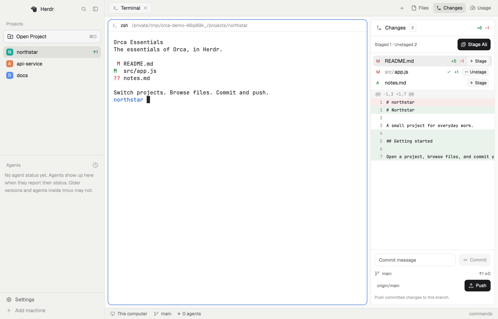

# Orca Essentials

**The essentials of Orca, in Herdr.**

A minimal Orca-inspired workspace built around three everyday tasks: switching projects, browsing files, and managing Git changes. Your terminal stays at the center, with short English labels and familiar icons around it.



- **Projects** — open a folder, switch between projects, and keep each project's terminals together. Opening the same folder returns to the existing project.
- **Files** — browse the project tree and preview files in the right panel.
- **Changes** — review diffs, **Stage All**, **Stage** or **Unstage** a file, enter a message and **Commit**, then **Push** to the displayed remote and branch. Unstage keeps your edits; Commit includes staged changes only; Push sends committed history.
- **Usage** — see account limits, used and remaining percentages, reset times, and available Codex credits. Accounts are shared across projects; these are not separate balances for each agent.

## Install

Paste this into your agent in Herdr:

```text
Read ~/.config/herdr-app/AGENTS.md, then add this layout: https://github.com/MJbae/herdr-orca-essentials
```

Use **Open Project** or **⌘O** to begin. Switch the right panel with **Files**, **Changes**, and **Usage**. Press Enter in the commit message field to commit, then use the separate **Push** button below it. Uncommitted edits stay local. Choose a remote if the target is ambiguous.

Tested with **Herdr 0.1.16 on macOS**. Requires Git and a remote for Push; other platforms are untested. File previews are read-only. The layout runs file-listing and Git commands. Push publishes the current branch and sets tracking for a new branch after success.

## Usage setup

[Preview the Usage panel with sample data](usage.png).

Requires Python 3 and the signed-in CLI on this computer: **Codex** with a ChatGPT account, **Antigravity** (`agy` 1.1.11 or newer), or **Claude Code**. For Claude, click **Set Up Claude** to connect its status line, then send a message in Claude. Any existing status-line command is preserved.

Antigravity shows Gemini and Claude + GPT limits for five-hour and weekly windows, plus model-specific limits when available. It uses the read-only `/usage` command supported since [Antigravity CLI 1.1.11](https://antigravity.google/docs/changelog).

Usage refreshes every five minutes while visible, or with **Refresh**. Missing or old data is marked explicitly. Credits keep their provider's units; remaining tokens are not estimated. Remote projects still show this computer's accounts.

Community layout inspired by Orca, adapted from [Herdr](https://github.com/herdrdev/herdr-app)'s Apache-2.0 layout and mods. See [RECIPE.md](RECIPE.md) for the build brief and [LICENSE](LICENSE) for the license.
