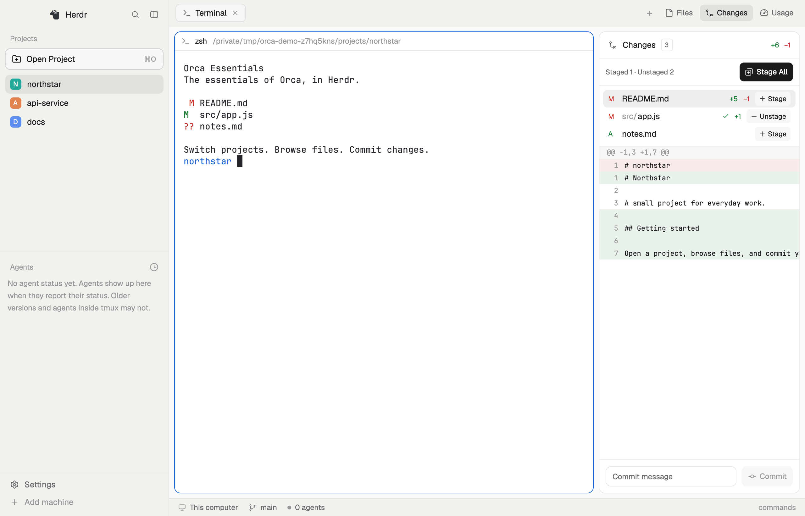

# Orca Essentials

The essentials of Orca, in Herdr: a minimal workspace for switching projects, browsing files, and staging and committing changes beside your terminal. Use short English labels and small line icons. This is a community layout inspired by Orca.

## What you see

A native three-column window. The 268 px left sidebar contains Herdr's 46 px brand bar, **Projects** with **Open Project**, the agent list, and a 69 px settings footer. Projects have colored initial badges and optional branch and ahead/behind counts.

The center has a 42 px tab bar and the active project's terminal panes. Panes have 30 px headers, 10 px rounded corners, and an accent border when focused. The body uses 8 px padding and gaps. A 28 px status bar sits below it.

The right panel starts at 320 px and resizes from 280 to 900 px. **Files**, **Changes**, and **Usage** buttons select its contents. Files shows a folder tree or read-only preview. Changes shows file counts, staging controls, file rows, a diff, and a commit message field. Usage shows provider cards with used/remaining percentages, bars, reset times, and optional credits. Use the user's theme and fonts; UI text is mostly 12–13 px. Colors come from Herdr's theme tokens.

## How it behaves

- **Open Project** / **⌘O** opens the native local folder picker. Select an existing project's folder to return to it; otherwise create a space with a Terminal tab. Cancel leaves the current project alone.
- Click projects or tabs to switch. Drag to reorder within their machine or project. Keep native right-click menus, tab renaming and closing, and the `+` menu. Nest worktrees under their repository. Hover ↑/↓ counts to see their relation to upstream.
- **Files** expands folders on demand. Clicking a file opens its preview; the back chevron returns to the tree. Anchor the tree to the project's folder. Remember expanded folders and previews while the mod lives.
- Remember the selected right panel per project; new projects start with Files. Clicking the active panel button hides it.
- **Stage All** stages all changes. Each row has **Stage** or **Unstage**; unstaging changes the index only. A check means staged; a half-filled circle means partially staged. Hover for explanations. Click a row to preview its diff.
- **Commit** or Enter commits staged changes with the entered message. Disable it without a message or staged changes, while busy, or with unresolved conflicts. Show errors and completion messages. There is no push action.
- **Usage** shows accounts on this computer, shared across projects and agents. Refresh on first opening, every five minutes while visible, or with **Refresh**. Show update time, stale data, and unavailable states; never replace missing data with zero. Keep credits in provider units and do not estimate remaining tokens. Claude's **Set Up Claude** explicitly installs its status-line connection while preserving any existing command.
- Preserve native agent status: working uses a spinner, blocked uses a “Needs you” badge or `!`, done uses a filled dot, and idle uses an outlined dot. Tabs show a spinner or blocked/done dot; idle tabs have no status mark. Status colors follow the theme.

## Built from

`layouts/orca-essentials.json` has a root row: `sidebar` and `work`. The sidebar holds `brand`, `sidebar-lists` (projects and agents), and `sidebar-footer`. Work holds `tabs-row`, `work-body` (active tab and `panel`), and `status`. `panel-body` is a Files/Changes/Usage stack.

Six custom mods provide the behavior:

- `project-spaces`: project list, folder button, Git metadata, and machine/worktree grouping.
- `project-open`: a 400 × 150 dialog that calls `pickFolder`, closes its overlay, then selects or creates a space.
- `project-tabs`: native tabs plus panel toggles; props are `panels: ["files", "changes", "usage"]` and `default_panel: "files"`.
- `project-files`: lazy file listing and a read-only `Editor` preview.
- `project-changes`: status, diff, staging, and commit; `git.js` performs Git operations.
- `project-usage`: usage cards; `collect.py` reads provider limits and `claude_usage.py` manages the optional Claude status-line connection. Bundle both Python helpers with the mod.

Use `gpui-kit` / `gpui-base`, Herdr's `spaces`, `panes`, `focused`, `layout`, `theme`, `settings`, `run`, overlays, shared/local state, `exec`, `hc`, `readTextFile`, and `watchFolder`. Reuse shipped `workspace-chrome`, `agents`, `pane`, `workspace-status`, `menu`, `new-menu`, and `machine-add` mods and shipped icons. Bundle the custom SVG assets. The footer passes `{footer: true}` to `workspace-chrome`.

## Watch out

Tested on macOS with Herdr 0.1.16 and Git. **⌘O** is a macOS binding; other platforms need key review and testing. The folder picker opens local projects. Existing remote spaces use Herdr's machine connection.

The mods read project files, run `git` and `hc`, and list directories through `sh` or PowerShell. Git writes occur through staging and commit actions. Preserve literal path arguments, conflict checks, busy/context guards, and `checking()` guards. Files and Changes refresh through local watches plus 10-second polling. The displayed diff compares the working tree with HEAD; it is not a staged-only preview.

Usage requires Python 3 and each provider's signed-in local CLI. Codex uses read-only app-server account methods with ChatGPT authentication; API-key accounts do not supply these limits. Antigravity is currently unavailable: a minimum CLI version alone did not establish safe `/usage` support. Keep the verified-version allowlist empty until a compatible usage command has been confirmed. Do not probe unverified versions. Any future adapter must persist its guard before invoking the command and clear it only after a valid usage response. Claude receives allowlisted limit fields from status-line input and stores them in a private local cache (mode `0600`); do not store the full input. Setup is a user action, not part of layout installation. Usage remains local even when a remote project is selected.

File browsing is limited to 500 entries per folder, 5,000 total, and depth 40. Text previews truncate at 400,000 characters. Changes displays the first 1,000 files and up to 1,500 diff lines; counts and Stage All cover the whole repository. Staging is file-level, not hunk-level.

Install beside existing layouts and mods, resolving name collisions. Merge only the supplied key snippet. Copy `layouts/orca-essentials.png` with the layout; keep the root `preview.png` and recipe as sharing assets. Do not copy personal state, project lists, or terminal history.

## Done when

Run `herdr-app check` on all six mods and `python3 -m unittest discover -s tests`, then try the layout in Herdr. Open two projects and verify switching and duplicate-folder reuse. Expand folders, preview a file, and return. In a disposable Git repository, stage all changes, unstage one file without losing edits, and commit the remainder. Confirm partially staged files, empty and non-Git states, conflicts, and project switching display correctly. Verify panel memory, icons, and readable labels at the default width.

Open Usage and verify available providers, manual refresh, percentages, reset times, and missing/stale states. Check that hidden panels do not poll and Antigravity setup states do not trigger automatic retries. Test Claude installation and command preservation in a temporary configuration. Keep account data out of published previews and fixtures.
